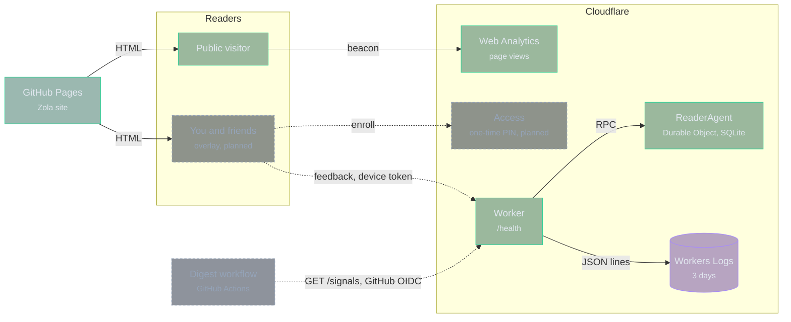

# Signals

A Cloudflare Worker for the digest's private feedback: taps on stories, story
requests, and owner notes from you and a few friends. It replaces the GitHub
issue paths. Public traffic goes to Cloudflare Web Analytics instead. The
Worker runs on the Workers Free plan and stores no long-lived secret.

## Architecture

Solid boxes exist. Dashed boxes are planned.

## Inspecting problems

| Question               | Where to look                                                      |
| ---------------------- | ------------------------------------------------------------------ |
| Is it up?              | `GET /health` answers `{"ok": true, "schema": N}` via the agent    |
| What failed?           | `error` events in Workers Logs, with the stack                     |
| Did the schema change? | `schema_migrated` events                                           |
| What is happening now? | `mise run signals:tail`                                            |

Every log line is one JSON object with an `event` field. Workers Logs in the
Cloudflare dashboard keeps every request and log line for 3 days and filters on
any field.

## Development

`mise tasks` lists the `signals:*` tasks. `signals:check` runs the tests inside
workerd with real Durable Object storage.

## Deployment

Workers Builds deploys from `main` through Cloudflare's GitHub App, so the
repository holds no Cloudflare token. Its settings:

- Root directory: `signals`
- Build command: `npm ci`
- Deploy command: `npx wrangler deploy`
- Build variable `NODE_VERSION`: the `node` version in `mise.toml`

## Changing the schema

`MIGRATIONS` in `src/agent.ts` lists the schema changes in order. Append a new
entry and never edit one that has shipped. The agent applies pending entries
when it starts, inside one transaction, and logs `schema_migrated`.
