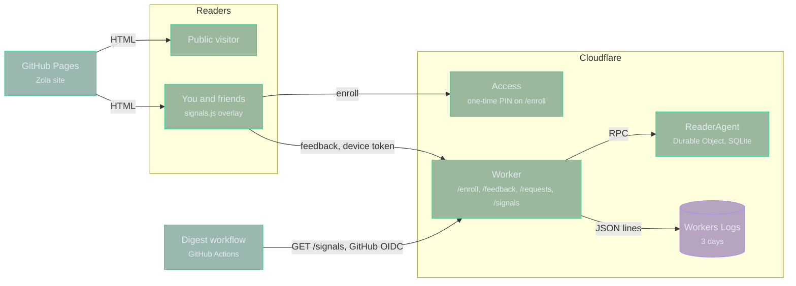

# Signals

A Cloudflare Worker for the digest's private feedback: taps on stories, story
requests, and owner notes from you and a few friends. It replaces the GitHub
issue paths. The Worker runs on the Workers Free plan and stores no long-lived
secret.

## Architecture

## Inspecting problems

| Question               | Where to look                                                      |
| ---------------------- | ------------------------------------------------------------------ |
| Is it up?              | `GET /health` answers `{"ok": true, "schema": N}` via the agent    |
| What failed?           | `error` events in Workers Logs, with the stack                     |
| Did the schema change? | `schema_migrated` events                                           |
| Why did sign-in fail?  | `enroll_rejected` and `auth_rejected` events, with a `reason`      |
| What is happening now? | `mise run signals:tail`                                            |

Every log line is one JSON object with an `event` field. Workers Logs in the
Cloudflare dashboard keeps every request and log line for 3 days and filters on
any field.

## Development

`mise tasks` lists the `signals:*` tasks. `signals:check` runs the tests inside
workerd with real Durable Object storage.

## Deployment

Workers Builds deploys from `main` through Cloudflare's GitHub App, so the
repository holds no Cloudflare token. Its settings:

- Root directory: `signals`
- Build command: `npm ci`
- Deploy command: `npx wrangler deploy`
- Build variable `NODE_VERSION`: the `node` version in `mise.toml`

## Enrollment

Cloudflare Access guards `/enroll` with a one-time PIN, and its policy lists
who may enroll. The Worker checks the Access token itself, issues a random
token for the device, and redirects to the site with it in the URL fragment.
It stores only the token's SHA-256 hash. `OWNER_EMAIL`, a Worker secret, marks
the owner. Enrolling a sixth device revokes the least recently used one.

## Feedback

`site/static/signals.js` reads the device token and draws the overlay: more,
less, knew it, and follow on every story, a note for the owner, and a panel to
suggest stories. A browser without a token sends nothing. Feedback belongs to
the reader, so every enrolled device shows the same state. A friend's story
request waits until the owner approves it in the panel.

## Digest runs

`agent/src/digest/signals.py` reads `GET /signals` with the job's GitHub OIDC
token. The Worker admits only `digest.yml` on `main` in this repository. The
daily run covers approved story requests, and the publish job marks the ones it
used through `POST /signals/used`. The weekly run reads the week's feedback
totals and the owner's notes. Outside GitHub Actions there is no OIDC token, so
local runs go on without signals.

## Changing the schema

`MIGRATIONS` in `src/agent.ts` lists the schema changes in order. Append a new
entry and never edit one that has shipped. The agent applies pending entries
when it starts, inside one transaction, and logs `schema_migrated`.
